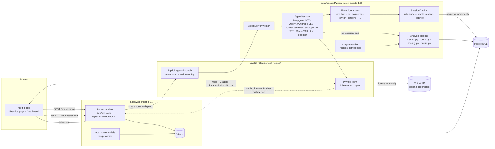

# Architecture

Fluent is a single-user web app (Next.js) plus a Python voice-agent worker (LiveKit Agents), sharing one
Postgres database. LiveKit carries the real-time audio; the agent runs the STT → LLM → TTS pipeline, logs
every utterance with word timings, and analyses the session when it ends.

## Session lifecycle

1. **Create** — `POST /api/sessions` validates the config (zod), enforces the daily-minutes cap, supersedes any
   still-live session, creates `Session{status: starting}`, creates a private LiveKit room (max 2 participants),
   explicitly dispatches `fluent-agent` with the session config as dispatch metadata, mints a short-lived join
   token for the owner, and optionally starts an audio-only Egress recording.
2. **Live** — the Practice page joins the room. The agent worker receives the job, loads the scenario and learner
   profile from Postgres, builds instructions (`prompt.py`), greets with `session.say(agentOpeningLine)` and marks
   the session `live` (only if still `starting`). Every final transcript, agent turn, tool call, interruption,
   hint, code-switch and latency sample is written incrementally through `SessionTracker`.
3. **End** — the learner presses End (`POST /api/sessions/:id/end` → status `analyzing`, room deleted), the session
   timer fires, the learner goes away for 2 minutes, or the agent calls `end_session_with_summary`. The agent's
   `on_session_end` hook finalises the row and runs the analysis pipeline. The LiveKit webhook (`room_finished`)
   is the safety net that moves a stuck `live` session forward; the web app sweeps sessions stuck in `analyzing`
   for more than five minutes to `failed` with a Retry button; `analysis-worker --watch` retries them.
4. **Report** — `AnalysisReport` (JSONB + normalised `MetricPoint`, `GrammarError`, `VocabEntry` rows) and the
   `UserProfile` are upserted; the report page polls until `complete` and renders.

## Data model

See `apps/web/prisma/schema.prisma` (mirrored for the agent in `apps/agent/src/fluent_agent/schemas.py`;
the shared JSON Schemas in `packages/shared/schemas` are the contract between the two, validated by tests on
both sides). Prisma owns migrations; the agent uses asyncpg with the same column names.

## Where things live

| Concern                           | Path                                                                                           |
| --------------------------------- | ---------------------------------------------------------------------------------------------- |
| Design system tokens / primitives | `apps/web/src/app/globals.css`, `apps/web/src/components/ui`                                   |
| App shell (navbar, tab bar, ⌘K)   | `apps/web/src/components/shell`                                                                |
| Practice flow                     | `apps/web/src/components/practice`, `apps/web/src/app/(app)/practice`                          |
| Session backend                   | `apps/web/src/lib/sessions.ts`, `apps/web/src/lib/livekit.ts`, `apps/web/src/app/api/sessions` |
| Dashboard queries                 | `apps/web/src/lib/queries`                                                                     |
| Agent worker                      | `apps/agent/src/fluent_agent/main.py` (entrypoint, tools, watchdog)                            |
| Providers / voices                | `apps/agent/src/fluent_agent/providers.py`                                                     |
| Persistence from the agent        | `apps/agent/src/fluent_agent/tracker.py`, `db.py`                                              |
| Analysis                          | `apps/agent/src/fluent_agent/analysis/`                                                        |
| Scenario content                  | `apps/web/prisma/seed-data/`                                                                   |
| Simulations                       | `apps/agent/scenarios/*.yaml`                                                                  |
